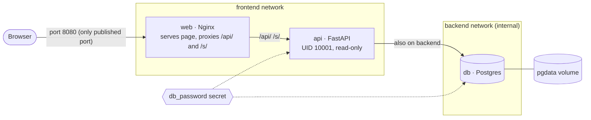

# Docker Capstone: Shortly, a Three-Tier Stack Built with Dockerfiles and Compose

Oct 25, 2026 · @Nicolas

## Overview

You will containerise **Shortly**, a small link shortener like bit.ly, as a three-tier system: an Nginx web tier, an API tier and a Postgres database tier. **You write no application code.** The app, database schema, web page and Nginx config are given further down, already tested; you copy them in. Your job is the part that matters here: **three Dockerfiles and one compose file**, built up in 11 small steps.

**The learning ladder**

| Step | You write | What it teaches |
| --- | --- | --- |
| 1 | `web/Dockerfile` | `FROM`, `COPY`, `EXPOSE`, `HEALTHCHECK`: customising an official image |
| 2 | `db/Dockerfile` | Extending an image's entrypoint with init scripts; why secrets never go in a Dockerfile |
| 3 | `api/Dockerfile` v1 | Building an app image: `WORKDIR`, `RUN`, `ENV`, `CMD` |
| 4 | `api/Dockerfile` v2 | Layer caching, non-root `USER`, multi-stage builds, `.dockerignore` |
| 5 | `docker run` commands | Running containers by hand: networks, ports, env vars, logs |
| 6 | `compose.yaml` v1 | One service: `image`, `build`, `environment`; `up`, `down`, `logs` |
| 7 | `compose.yaml` v2 | Two services talking over a private network |
| 8 | `compose.yaml` v3 | All three tiers: `ports`, `healthcheck`, `depends_on` |
| 9 | `compose.yaml` v4 | Named volumes, `.env` files, secrets |
| 10 | `compose.yaml` v5 | Restart policy, resource limits, log rotation, hardening |
| 11 | Nothing new | Break-it drills: diagnosing failures from evidence |

Each step adds to the file from the step before, so you never start from a blank page twice. Expect about one evening per two steps.

## How each step works

Every step has the same four parts:

1. **Blueprint:** what each line of your file must do, in plain English, with the instruction or key name in bold. You turn each line into syntax.
2. **Look up:** the exact reference page and section with that syntax and an example.
3. **Check:** commands that prove it works. A step isn't done until its check passes.
4. **Explain:** one or two questions to answer in your Git commit message. If you can explain it, you've learned it.

**Where the syntax lives** (bookmark these four)

| For | Official reference |
| --- | --- |
| Every Dockerfile instruction | [Dockerfile reference](https://docs.docker.com/reference/dockerfile/) |
| Every compose key | [Compose file reference](https://docs.docker.com/reference/compose-file/), mostly the [Services page](https://docs.docker.com/reference/compose-file/services/) |
| How to write good Dockerfiles | [Building best practices](https://docs.docker.com/build/building/best-practices/) and [Multi-stage builds](https://docs.docker.com/build/building/multi-stage/) |
| What is inside each image (env vars, paths, tags) | Docker Hub pages: [nginx](https://hub.docker.com/_/nginx), [postgres](https://hub.docker.com/_/postgres), [python](https://hub.docker.com/_/python) |

**Using a reference page:** use your browser's find to jump to the one instruction or key you need. Read its example and note whether it expects a single value, a list or a map. Close the page and write your line, then reopen it only to check.

**YAML rules behind most compose errors**

- Indent with **spaces only**, and the same amount at every level (2 is standard). A tab breaks the file.
- A list item is a dash **followed by a space**.
- A key is followed by a colon **and a space**. A key with nothing after it opens a nested block.
- Put quotes around port mappings and around values like `yes`, `no`, `on` and `off`.

**Tools that catch mistakes as you type:** VS Code with the Docker extension and Red Hat's YAML extension (autocomplete and red underlines for compose files), `docker compose config` (validates and shows what Compose understood), and `hadolint` for Dockerfiles (`brew install hadolint`).

**One rule:** don't use `docker init` or copy Dockerfiles from blogs or AI until you finish. Afterwards, comparing them with yours is a great review.

## Architecture

This is what you'll have at the end of Step 10. Each box is an image you build from your own Dockerfile. Requests flow left to right, and each tier can reach only the tier next to it.



*Shortly at the end of Step 10: 3 custom images, 2 networks, 1 volume, 1 secret.*

- **One way in.** Only the web tier publishes a port. It serves the page and forwards `/api/` and `/s/` to the API.
- **The API is the bridge.** It's the only service on both networks.
- **The database can't reach out.** Its network is internal: no internet route, even if it's compromised.
- **State lives outside the containers.** Containers are rebuilt on every change; only the volume and the secret persist.

## Given files

Copy these exactly. You don't need to understand the code; each has a one-line summary so you know what it does. All of them were run and tested together before going in this doc.

**Folder layout.** Files marked *you* are the ones you write.

```text
shortly/
├── compose.yaml            you (Steps 6-10)
├── .env                    you (Step 9), never committed
├── .gitignore
├── secrets/                you (Step 9), never committed
├── web/
│   ├── Dockerfile          you (Step 1)
│   ├── nginx.conf
│   └── index.html
├── db/
│   ├── Dockerfile          you (Step 2)
│   └── init.sql
└── api/
    ├── Dockerfile          you (Steps 3-4)
    ├── .dockerignore       you (Step 4)
    ├── requirements.txt
    └── main.py
```

**`.gitignore`**: keeps secrets and junk out of Git.

```text
.env
secrets/
backups/
__pycache__/
.venv/
```

**`web/nginx.conf`**: serves the web page, and forwards `/api/` and `/s/` requests to the service named `api` on port 8000. `/nginx-health` is Nginx's own health endpoint.

```nginx
server {
    listen 80;
    server_name _;
    server_tokens off;

    root  /usr/share/nginx/html;
    index index.html;

    # Look up "api" through Docker's internal DNS at request time, not once
    # at startup. Nginx then starts even if the API isn't up yet, and follows
    # the API to its new address after it is recreated.
    resolver 127.0.0.11 valid=10s ipv6=off;
    resolver_timeout 5s;
    set $api_upstream http://api:8000;

    # Nginx's own healthcheck: answers without touching the API
    location = /nginx-health {
        access_log off;
        default_type text/plain;
        return 200 "ok\n";
    }

    # API calls and short links go to the api service
    location /api/ {
        proxy_pass $api_upstream;
        proxy_set_header Host              $host;
        proxy_set_header X-Real-IP         $remote_addr;
        proxy_set_header X-Forwarded-For   $proxy_add_x_forwarded_for;
        proxy_set_header X-Forwarded-Proto $scheme;
    }

    location /s/ {
        proxy_pass $api_upstream;
        proxy_set_header Host              $host;
        proxy_set_header X-Real-IP         $remote_addr;
        proxy_set_header X-Forwarded-For   $proxy_add_x_forwarded_for;
        proxy_set_header X-Forwarded-Proto $scheme;
    }

    # Everything else is the static web page
    location / {
        try_files $uri $uri/ =404;
    }
}
```

**`web/index.html`**: the page with the "Shorten" form.

```html
<!DOCTYPE html>
<html lang="en">
<head>
  <meta charset="utf-8">
  <meta name="viewport" content="width=device-width, initial-scale=1">
  <title>Shortly</title>
  <style>
    body { font-family: system-ui, sans-serif; max-width: 560px; margin: 4rem auto; padding: 0 1rem; }
    input { width: 100%; padding: .6rem; font-size: 1rem; box-sizing: border-box; }
    button { margin-top: .6rem; padding: .6rem 1.2rem; font-size: 1rem; }
    #result { margin-top: 1.2rem; font-size: 1.1rem; }
  </style>
</head>
<body>
  <h1>Shortly</h1>
  <form id="form">
    <input id="url" type="url" placeholder="https://example.com/a/very/long/link" required>
    <button type="submit">Shorten</button>
  </form>
  <div id="result"></div>

  <script>
    document.getElementById("form").addEventListener("submit", async (event) => {
      event.preventDefault();
      const result = document.getElementById("result");
      const response = await fetch("/api/links", {
        method: "POST",
        headers: { "Content-Type": "application/json" },
        body: JSON.stringify({ url: document.getElementById("url").value }),
      });
      if (!response.ok) {
        result.textContent = "Error " + response.status;
        return;
      }
      const data = await response.json();
      const link = window.location.origin + data.short_url;
      result.innerHTML = '<a href="' + link + '">' + link + "</a>";
    });
  </script>
</body>
</html>
```

**`db/init.sql`**: creates the `links` table and one sample link (`/s/docker`). Postgres runs it once, the first time the database starts with an empty volume.

```sql
CREATE TABLE IF NOT EXISTS links (
    id         BIGSERIAL PRIMARY KEY,
    code       VARCHAR(16) NOT NULL UNIQUE,
    url        TEXT        NOT NULL,
    clicks     INTEGER     NOT NULL DEFAULT 0,
    created_at TIMESTAMPTZ NOT NULL DEFAULT now()
);

INSERT INTO links (code, url)
VALUES ('docker', 'https://docs.docker.com')
ON CONFLICT (code) DO NOTHING;
```

**`api/requirements.txt`**: the three Python packages the API needs.

```text
fastapi>=0.115,<1
uvicorn[standard]>=0.30,<1
psycopg[binary]>=3.2,<4
```

**`api/main.py`**: the API. What you need to know as the person containerising it:

- It is started with the command `uvicorn main:app --host 0.0.0.0 --port 8000`.
- It reads these environment variables: `DB_HOST`, `DB_NAME`, `DB_USER`, and either `DB_PASSWORD` or `DB_PASSWORD_FILE` (a path to a file containing the password).
- `/api/health` returns 200 when the database answers and 503 when it doesn't.

```python
import os
import secrets
import string
from pathlib import Path

import psycopg
from fastapi import FastAPI, HTTPException
from fastapi.responses import RedirectResponse
from pydantic import BaseModel, HttpUrl

ALPHABET = string.ascii_letters + string.digits


def db_password() -> str:
    # Step 9 uses a secret file; earlier steps use a plain variable.
    path = os.getenv("DB_PASSWORD_FILE")
    if path:
        return Path(path).read_text().strip()
    return os.getenv("DB_PASSWORD", "")


def connect():
    return psycopg.connect(
        host=os.getenv("DB_HOST", "db"),
        dbname=os.getenv("DB_NAME", "shortly"),
        user=os.getenv("DB_USER", "shortly"),
        password=db_password(),
        connect_timeout=3,
    )


app = FastAPI(title="Shortly")


class LinkIn(BaseModel):
    url: HttpUrl


@app.get("/api/health")
def health():
    try:
        with connect() as conn:
            conn.execute("SELECT 1")
    except Exception:
        raise HTTPException(status_code=503, detail="database unreachable")
    return {"status": "ok"}


@app.post("/api/links", status_code=201)
def create_link(link: LinkIn):
    code = "".join(secrets.choice(ALPHABET) for _ in range(6))
    with connect() as conn:
        conn.execute(
            "INSERT INTO links (code, url) VALUES (%s, %s)",
            (code, str(link.url)),
        )
    return {"code": code, "short_url": f"/s/{code}"}


@app.get("/api/links/{code}")
def link_stats(code: str):
    with connect() as conn:
        row = conn.execute(
            "SELECT url, clicks, created_at FROM links WHERE code = %s",
            (code,),
        ).fetchone()
    if row is None:
        raise HTTPException(status_code=404, detail="unknown code")
    return {"code": code, "url": row[0], "clicks": row[1], "created_at": row[2].isoformat()}


@app.get("/s/{code}")
def follow(code: str):
    with connect() as conn:
        row = conn.execute(
            "UPDATE links SET clicks = clicks + 1 WHERE code = %s RETURNING url",
            (code,),
        ).fetchone()
    if row is None:
        raise HTTPException(status_code=404, detail="unknown code")
    return RedirectResponse(row[0], status_code=307)
```

## Step 1: Dockerfile for the web tier

**Goal:** a custom Nginx image with your config and web page **baked in**, so it runs anywhere without mounting files. This is the simplest kind of Dockerfile: take an official image and add your files to it.

**Blueprint for `web/Dockerfile`** (one instruction per line)

1. Start **from** the official image `nginx:1.27-alpine`. Check the tags on the nginx Docker Hub page and use the current stable `-alpine` tag if a newer one exists. Never `latest`.
2. **Copy** `nginx.conf` into the image, replacing Nginx's default site config. The nginx Docker Hub page shows the folder where site configs live; the file there is `default.conf`.
3. **Copy** `index.html` into the folder Nginx serves pages from (the `root` line of `nginx.conf` tells you which).
4. Document that the container listens on port 80 with **expose**.
5. Add a **healthcheck** that runs every 30 seconds and requests `http://127.0.0.1/nginx-health` with BusyBox `wget` in quiet spider mode, which ships in the Alpine image. Use `127.0.0.1`, not `localhost`: inside Alpine, `localhost` can resolve to the IPv6 address, which this Nginx doesn't listen on.
6. No `CMD` line. The base image already defines how Nginx starts, and your image inherits it.

**Look up** in the [Dockerfile reference](https://docs.docker.com/reference/dockerfile/): `FROM`, `COPY`, `EXPOSE`, `HEALTHCHECK` (its options `--interval`, `--timeout`, `--retries`, and the `CMD` form that follows them).

**Check**

```bash
cd shortly
docker build -t shortly-web:1.0.0 ./web
docker run -d --name web-test -p 8080:80 shortly-web:1.0.0
# open http://localhost:8080 : the Shortly page appears
curl -s localhost:8080/nginx-health                 # ok
sleep 35 && docker ps                               # STATUS shows (healthy)
docker rm -f web-test
```

The Shorten button won't work yet, because there's no API. That's expected.

**Explain:** why does the image need no `CMD`? Run `docker image inspect nginx:1.27-alpine` and find where the start command comes from.

## Step 2: Dockerfile for the database tier

**Goal:** a Postgres image that creates the `links` table automatically on first start. You'll see how official images let you hook into their **entrypoint script**, the same `[Entrypoint]` you saw in the MySQL logs.

**Blueprint for `db/Dockerfile`**

1. Start **from** `postgres:16-alpine`.
2. **Copy** `init.sql` into the folder the Postgres entrypoint scans for init scripts, naming it `01-init.sql`. The folder is on the postgres Docker Hub page under "Initialization scripts". Scripts there run in alphabetical order, hence the `01-` prefix.
3. That's all. **Don't** set the password with `ENV` here. Anything in a Dockerfile is stored in the image and readable by anyone who pulls it (`docker history` shows it). Passwords are supplied when the container runs, never when the image is built.

**Look up:** "Initialization scripts" and "Environment Variables" on the [postgres Docker Hub page](https://hub.docker.com/_/postgres); `COPY` in the Dockerfile reference.

**Check**

```bash
docker build -t shortly-db:1.0.0 ./db

# 1. Start it WITHOUT a password: watch it refuse (same lesson as MySQL)
docker run --name db-test shortly-db:1.0.0
# Ctrl+C, then: docker rm db-test

# 2. Start it properly
docker run -d --name db-test \
  -e POSTGRES_USER=shortly -e POSTGRES_DB=shortly -e POSTGRES_PASSWORD=devpass \
  shortly-db:1.0.0
docker logs db-test | grep -i init           # shows 01-init.sql being run
docker exec db-test psql -U shortly -d shortly -c 'SELECT code, url FROM links;'
#  -> one row: docker | https://docs.docker.com
docker history shortly-db:1.0.0 | head -5    # your COPY layer, no password anywhere
docker rm -f db-test
```

**Explain:** the image has no `CMD` or `ENTRYPOINT` of its own, so who ran your SQL file? Find the answer with `docker image inspect postgres:16-alpine` (look at Entrypoint and Cmd).

## Step 3: Dockerfile for the API, first version

**Goal:** a working image of the Python app. This first version is deliberately simple and has two flaws you'll find in the check and fix in Step 4.

**Blueprint for `api/Dockerfile`**

1. Start **from** `python:3.12-slim`.
2. Set two **environment** variables in one instruction: `PYTHONDONTWRITEBYTECODE=1` (don't write `.pyc` files) and `PYTHONUNBUFFERED=1` (print logs immediately, so `docker logs` shows them in real time).
3. Set the **working directory** to `/app`. Every later instruction runs from there.
4. **Copy** everything in the `api` folder into the working directory.
5. **Run** `pip install` with `--no-cache-dir` and `-r requirements.txt`, so the packages are installed without leaving pip's download cache in the image.
6. Document port 8000 with **expose**.
7. Set the default **command** to `uvicorn main:app --host 0.0.0.0 --port 8000`, in exec form: a JSON array with each word as a separate quoted string.

**Look up** in the Dockerfile reference: `ENV`, `WORKDIR`, `RUN`, `CMD`, and the "Shell and exec form" section near the top.

**Check**

```bash
docker build -t shortly-api:1.0.0 ./api
docker run -d --name api-test -p 8000:8000 shortly-api:1.0.0
# open http://localhost:8000/docs : the API's interactive docs page
curl -s localhost:8000/api/health        # 503 "database unreachable": correct, there's no DB yet
docker logs api-test                     # uvicorn's startup lines
docker rm -f api-test
```

**Now find the two flaws:**

```bash
docker run --rm shortly-api:1.0.0 id     # flaw 1: uid=0(root)
touch api/main.py
docker build -t shortly-api:1.0.0 ./api  # flaw 2: pip reinstalls everything after a one-line change
```

**Explain:** why must the host be `0.0.0.0` and not `127.0.0.1` inside a container? And why does changing `main.py` force `pip install` to run again? (Hint: think about the order of your `COPY` and `RUN` lines and how layer caching works.)

## Step 4: API Dockerfile, production version

**Goal:** fix both flaws from Step 3, and learn the most important Dockerfile pattern there is: the **multi-stage build**. One stage installs things; a second, clean stage receives only the result. Rewrite `api/Dockerfile` from scratch using this blueprint.

**Blueprint, stage 1: the builder**

1. Start **from** `python:3.12-slim` and name this stage `builder`.
2. **Run** `python -m venv /opt/venv` to create a virtual environment: a self-contained folder of Python packages that's easy to copy.
3. Set **env** `PATH` so `/opt/venv/bin` comes first, followed by the existing `$PATH`. Now `pip` means the venv's pip.
4. **Copy only `requirements.txt`**, nothing else yet.
5. **Run** the same `pip install` as Step 3.

**Blueprint, stage 2: the final image**

6. Start **from** `python:3.12-slim` again: a fresh, clean image.
7. Set **env** for the two `PYTHON` variables from Step 3 and the same `PATH` as line 3.
8. **Run** `useradd` to create a user named `app` with UID `10001`, no home directory, and the shell `/usr/sbin/nologin`. *Look up:* `man useradd` for the `--uid`, `--no-create-home` and `--shell` flags.
9. **Copy** `/opt/venv` **from the builder stage** to the same path.
10. Set the **working directory** to `/app`.
11. **Copy** only `main.py` into it.
12. Switch **user** to `10001`. Use the number, not the name, because Kubernetes can only verify numbers.
13. **Expose** 8000 and set the same **CMD** as Step 3.

**Also write `api/.dockerignore`** with the files that must never be sent to the build: `.venv/`, `__pycache__/`, `*.pyc`, `.env`. This file uses the same pattern style as `.gitignore`.

**Look up:** [Multi-stage builds](https://docs.docker.com/build/building/multi-stage/) (naming stages with `AS`, `COPY --from`); `USER` in the Dockerfile reference; "Leverage build cache" and "User" in [Building best practices](https://docs.docker.com/build/building/best-practices/); the `.dockerignore` section of the Dockerfile reference.

**Check**

```bash
docker build -t shortly-api:1.1.0 ./api
docker run --rm shortly-api:1.1.0 id                 # uid=10001(app)  flaw 1 fixed
touch api/main.py && docker build -t shortly-api:1.1.0 ./api
#   the pip install step now says CACHED              flaw 2 fixed
docker image ls shortly-api                          # compare 1.0.0 and 1.1.0 sizes
hadolint api/Dockerfile                              # aim for no warnings
docker run -d --name api-test -p 8000:8000 shortly-api:1.1.0
curl -s localhost:8000/api/health                    # still 503 (no DB), so the app still works
docker rm -f api-test
```

**Explain:** why does copying `requirements.txt` on its own, before the code, make rebuilds fast? And what got left behind in the builder stage that isn't in your final image?

## Step 5: Run the three containers by hand

**Goal:** connect your three images into a working system using only `docker` commands. Typing each flag yourself is what makes the compose file make sense later: every line of it replaces one of these flags.

**The flags you'll need**

| Flag | What it does |
| --- | --- |
| `-d` | Run in the background (detached) |
| `--name` | Give the container a name. **On a user-defined network, this name is also its DNS hostname** |
| `--network` | Attach the container to a network |
| `-e NAME=value` | Set an environment variable (repeat for each one) |
| `-p host:container` | Publish a port to your Mac |

**Blueprint: write and run one command per line**

1. **Create a network** called `shortly-net`.
2. **Run the database:** detached, named `db`, on `shortly-net`, with `POSTGRES_USER=shortly`, `POSTGRES_DB=shortly` and `POSTGRES_PASSWORD=devpass`, from `shortly-db:1.0.0`. No `-p`: nothing outside should reach the database.
3. **Run the API:** detached, named `api`, on `shortly-net`, with `DB_HOST=db`, `DB_NAME=shortly`, `DB_USER=shortly` and `DB_PASSWORD=devpass`, from `shortly-api:1.1.0`. No `-p` either.
4. **Run the web tier:** detached, named `web`, on `shortly-net`, publishing host 8080 to container 80, from `shortly-web:1.0.0`.

See how the names connect everything: the API finds the database because it's **named** `db`, and Nginx finds the API because it's **named** `api`. Docker's built-in DNS turns container names into addresses, but only on networks you create yourself, not on the default one.

**Look up:** [`docker run`](https://docs.docker.com/reference/cli/docker/container/run/) and [`docker network create`](https://docs.docker.com/reference/cli/docker/network/create/).

**Check**

```bash
docker ps                                          # db, api, web all Up
curl -s localhost:8080/api/health                  # {"status":"ok"}
curl -s -X POST localhost:8080/api/links \
  -H 'Content-Type: application/json' -d '{"url":"https://docs.docker.com/compose/"}'
#   -> {"code":"aB3x9Q","short_url":"/s/aB3x9Q"}
curl -s -o /dev/null -w '%{http_code} %{redirect_url}\n' localhost:8080/s/aB3x9Q
#   -> 307 https://docs.docker.com/compose/       (use your own code)
curl -s localhost:8080/api/links/aB3x9Q            # clicks: 1
# open http://localhost:8080 and shorten a link with the form
docker logs api                                    # you'll see each request
```

**Tear down and count:** remove the three containers, then the network. Count every command you typed to bring it up and take it down. Then notice that your shortened links are **gone**: there was no volume. Steps 6 to 9 fix both problems.

**Explain:** why can `web` reach `api` by name here, when in Step 1 it was alone on the default network?

## Step 6: First compose file, one service

**Goal:** your first `compose.yaml`, with only the database in it. Small enough to get the YAML structure right before adding more.

**Blueprint for `compose.yaml`** (in the `shortly/` folder)

1. A top-level **`services`** key. Everything in this step sits under it.
2. Under it, a service named **`db`**. The service name matters: it becomes the DNS hostname, exactly like `--name` in Step 5.
3. Under `db`, a **`build`** key pointing at the `./db` folder, so Compose builds your Dockerfile from Step 2.
4. Also under `db`, an **`image`** key with `shortly-db:1.0.0`. With both `build` and `image` set, Compose builds the image and gives it that name and tag.
5. Under `db`, an **`environment`** key with the three `POSTGRES_` variables from Step 5. Use the map style (`NAME: value` on each line).

No `version:` line at the top. It's obsolete.

**Look up** on the [Services reference](https://docs.docker.com/reference/compose-file/services/): `build`, `image`, `environment`. Note that `environment` accepts two styles, a map and a list, and pick one.

**Check**

```bash
docker compose config                 # no errors; prints your file as Compose understood it
docker compose up -d --build
docker compose ps                     # one container: shortly-db-1, running
docker compose logs db | grep -i init
docker compose exec db psql -U shortly -d shortly -c 'SELECT code FROM links;'
docker compose down
```

Notice the container is called `shortly-db-1`: Compose names things *project-service-number*, and the project name defaults to the folder name. Also notice you never created a network: Compose made one called `shortly_default` and removed it on `down`.

**Explain:** compare this file with your Step 5 command for the database. Which flag became which key? Which flag disappeared, and why?

## Step 7: Compose, add the API and networks

**Goal:** two services talking to each other over networks **you** define, with the database on a network that has no route to the internet. This is the core of three-tier design: each tier reaches only the tier next to it.

**Blueprint: add to `compose.yaml`**

1. A second service, **`api`**, with `build` pointing at `./api` and `image` set to `shortly-api:1.1.0`.
2. Its **`environment`**: `DB_HOST`, `DB_NAME`, `DB_USER` and `DB_PASSWORD`, with the same values as Step 5. (The password moves out of this file in Step 9.)
3. A **temporary** `ports` entry publishing `"8000:8000"`, so you can test the API directly in this step. Quote it. You'll delete it in Step 8.
4. **`depends_on`** listing `db`, in the short list form.
5. A new **top-level `networks`** key (at the same level as `services`) defining two networks: **`frontend`**, and **`backend`** with `internal` set to `true`.
6. Under `db`, a **`networks`** key listing only `backend`.
7. Under `api`, a **`networks`** key listing both `frontend` and `backend`. The API is the bridge between the tiers.

**Look up:** `networks` and `depends_on` on the [Services reference](https://docs.docker.com/reference/compose-file/services/); the top-level [Networks reference](https://docs.docker.com/reference/compose-file/networks/), especially `internal`; `ports` (short syntax) on the Services page.

**Check**

```bash
docker compose config -q && echo valid
docker compose up -d --build
docker network ls | grep shortly                       # shortly_frontend and shortly_backend
docker network inspect shortly_backend --format '{{.Internal}}'   # true
curl -s localhost:8000/api/health                      # {"status":"ok"}  (if 503, wait 5s and retry: see Explain)
curl -s localhost:8000/api/links/docker                # the sample link from init.sql
docker compose exec db ping -c1 -W2 8.8.8.8            # must FAIL: backend is internal
docker compose down
```

**Explain:** right after `up`, `/api/health` may briefly return 503 even though the API container is running. Why? What does `depends_on` actually wait for in its short form? (Step 8 fixes this properly.)

## Step 8: Compose, add the web tier, healthchecks and start-up order

**Goal:** the full three-tier stack in one command, starting in the right order, with only the web tier reachable from outside.

**Blueprint: change `compose.yaml`**

1. **Delete** the temporary `ports` entry from `api`. From now on, only the web tier is published.
2. Add a **healthcheck** to `db`. Its test, in the list form that starts with `CMD`, runs `pg_isready -U shortly -d shortly`. Set the interval to 5s, timeout to 3s, retries to 10 and start period to 20s.
3. Add a **healthcheck** to `api`. Its test runs this exact command (Python, given so you don't have to write it), which exits 0 when the API reports healthy: `python -c "import urllib.request; urllib.request.urlopen('http://127.0.0.1:8000/api/health', timeout=3)"` Use the list form with `CMD`, so `python`, `-c` and the quoted program are three separate items. Same timings as `db`.
4. Change the api's **`depends_on`** to the **long form**: `db` with `condition: service_healthy`.
5. Add a third service, **`web`**: `build` from `./web`, `image` `shortly-web:1.0.0`, on the **`frontend`** network only, publishing `"8080:80"`, and depending on `api` with `condition: service_healthy`.
6. No healthcheck for `web` in the compose file: it already has one from its Dockerfile (Step 1), and Compose uses it.

**Look up:** `healthcheck` and the long syntax of `depends_on` on the [Services reference](https://docs.docker.com/reference/compose-file/services/), and the how-to [Control startup order](https://docs.docker.com/compose/how-tos/startup-order/).

**Check**

```bash
docker compose config -q && docker compose up -d --build
docker compose ps                       # watch STATUS: db healthy first, then api, then web
curl -s localhost:8080/api/health       # {"status":"ok"}
# open http://localhost:8080 and shorten a link; open the short link
curl -s --max-time 3 localhost:8000/api/health   # must FAIL: api is no longer published
docker compose exec web ping -c1 db              # must FAIL: web can't even see db
docker inspect --format '{{json .State.Health}}' shortly-api-1   # the last 5 health results
```

**Explain:** draw (on paper) which service is on which network and which port is published. Then explain why `web` can reach `api` but not `db`.

## Step 9: Compose, volumes, `.env` and secrets

**Goal:** links survive restarts, and no password appears in `compose.yaml`, in Git, or in `docker inspect`.

**Part A: persistence**

1. Add a **top-level `volumes`** key defining a named volume, `pgdata`.
2. Under `db`, a **`volumes`** entry mounting `pgdata` at Postgres's data directory, `/var/lib/postgresql/data` (it's on the postgres Docker Hub page under "PGDATA").

**Part B: settings in `.env`**

3. Create a `.env` file next to `compose.yaml` with three lines: `DB_NAME=shortly`, `DB_USER=shortly`, `WEB_PORT=8080`.
4. In `compose.yaml`, replace those hard-coded values with **variables that have defaults**, so the file still works without `.env`. For example, the web port mapping becomes the `WEB_PORT` variable (default 8080) followed by `:80`. Use the same variables for both the `POSTGRES_` and `DB_` settings, so they can't drift apart.

**Part C: secrets**

5. Create the password file (it's in `.gitignore`): `mkdir -p secrets && openssl rand -hex 24 | tr -d '\n' > secrets/db_password.txt`
6. Add a **top-level `secrets`** key defining `db_password`, read from that file.
7. Grant the secret to **`db`** and **`api`** only, with a `secrets` key under each. **Not** `web`.
8. In `db`'s environment, replace `POSTGRES_PASSWORD` with **`POSTGRES_PASSWORD_FILE`** set to `/run/secrets/db_password`.
9. In `api`'s environment, replace `DB_PASSWORD` with **`DB_PASSWORD_FILE`**, same path. The given `main.py` already reads it.

**Look up:** [Top-level volumes](https://docs.docker.com/reference/compose-file/volumes/); [variable interpolation](https://docs.docker.com/compose/how-tos/environment-variables/variable-interpolation/) for the default-value syntax; [Use secrets in Compose](https://docs.docker.com/compose/how-tos/use-secrets/) and [Top-level secrets](https://docs.docker.com/reference/compose-file/secrets/); "Docker Secrets" on the postgres Docker Hub page for the `_FILE` variables.

**Check**

```bash
docker compose down -v                  # start clean (the old db had a different password)
docker compose config | grep -iE 'password|secret'   # only file paths, no password values
docker compose up -d --build && docker compose ps    # all healthy
# shorten a link in the browser, note its code, then:
docker compose down && docker compose up -d
curl -s localhost:8080/api/links/<code>              # still there: the volume kept it
docker inspect shortly-api-1 --format '{{json .Config.Env}}'   # DB_PASSWORD_FILE path, no password
docker compose exec web ls /run/secrets              # fails: web was never given the secret
```

**Explain:** what happens if you change `db_password.txt` after the database already exists? (Remember the MySQL lesson: the password is read only when the volume is empty.)

## Step 10: Compose, production settings

**Goal:** the settings that separate "it runs on my laptop" from "I'd trust it in production": automatic recovery, resource ceilings, bounded logs and a smaller attack surface.

**Blueprint: add to `compose.yaml`**

1. **`restart: unless-stopped`** on all three services.
2. **Resource limits** under `deploy`, on each service: api 0.5 CPU and 256M memory; db 1.0 CPU and 512M; web 0.25 CPU and 64M.
3. **Log rotation, written once.** At the top of the file, add an extension block whose name starts with `x-` (for example `x-logging`). Give it a YAML anchor and put in it a `logging` setting with the `json-file` driver, `max-size` `"10m"` and `max-file` `"3"`. Then reuse it on every service with the anchor's alias. Docker's default keeps logs forever, and disks filled by logs are a classic outage.
4. **Harden the API** (it handles input from the internet):
   - `read_only: true`: the container can't write to its own filesystem.
   - `tmpfs` at `/tmp`: the one writable scratch folder.
   - `cap_drop` set to `ALL`: it listens above port 1024, so it needs no Linux capabilities.
5. **`security_opt`** with `no-new-privileges:true` on all three services.

**Look up:** `restart`, `deploy` (resources, limits), `logging`, `read_only`, `tmpfs`, `cap_drop` and `security_opt` on the [Services reference](https://docs.docker.com/reference/compose-file/services/); [Extensions](https://docs.docker.com/reference/compose-file/extension/) for the `x-` block and anchors.

**Check**

```bash
docker compose config -q && docker compose up -d --build && docker compose ps
docker stats --no-stream                               # MEM LIMIT column shows your ceilings
docker compose exec api touch /app/hack                 # Read-only file system
docker compose exec api sh -c 'grep CapEff /proc/self/status'   # all zeros
docker compose exec api id                              # uid=10001

# Crash recovery: kill the API's main process, watch it come back
docker compose exec api sh -c 'kill 1'      # sh's built-in kill; the slim image may lack /bin/kill
sleep 10 && docker compose ps                           # api running again, then healthy

# Scan the API image for known vulnerabilities
docker scout quickview shortly-api:1.1.0                # or: trivy image shortly-api:1.1.0
```

**Upgrade and rollback drill:** in a second terminal, run `while true; do curl -s -o /dev/null -w '%{http_code} ' localhost:8080/api/health; sleep 0.5; done`. Change the api's image tag to `1.2.0` and run `docker compose up -d --build api`. A few `502`s appear: with one copy of the API, every deploy has a brief outage. Kubernetes rolling updates exist to solve exactly this. Then set the tag back to `1.1.0` and `up -d api` again: rollback is instant, because the old image is still on disk.

**Explain:** why is `unless-stopped` usually better than `always`? And what would an attacker who got code running inside the API be unable to do now?

## Step 11: Break-it drills

**Goal:** learn what each kind of failure looks like now, in a lab, so you recognise it in seconds when it's real. Break **one** thing, diagnose it using only `docker compose config`, `ps`, `logs`, `inspect` and `curl`, name the cause, then undo it.

| # | Break it | What you should see | Layer |
| --- | --- | --- | --- |
| 1 | Indent one key under `api` by one extra space | `config` rejects the file; nothing starts | YAML |
| 2 | Write a port mapping without a list dash | `config` says ports must be a list | Compose schema |
| 3 | Misspell `POSTGRES_PASSWORD_FILE` in the db service, then `down -v` and `up` | db exits: "password option is not specified" (the MySQL error again) | Image config |
| 4 | Remove `backend` from the api's networks | api never turns healthy; web never starts | Network |
| 5 | Change the api healthcheck to use `curl` | api stuck unhealthy: the slim image has no curl | Healthcheck |
| 6 | In `db/Dockerfile`, copy `init.sql` to the wrong folder, rebuild, `down -v`, `up` | Everything is healthy, but shortening returns 500: the table doesn't exist | Image build |
| 7 | Run something else on port 8080 first, then `up` | web fails: port is already allocated | Host |
| 8 | `docker compose stop db` while it's all running | The page loads and `/nginx-health` is fine, but shortening fails: a partial outage | Dependency |

For each drill, add three lines to a `DRILLS.md` file: **symptom** (what a user would see), **root cause**, and **what would have caught it earlier**.

Drill 6 is the most valuable: every health check is green, yet the app is broken, because the healthcheck only tests that the database *answers*, not that the *table exists*. Ask yourself what a better healthcheck would test.

## Cheat sheet

Everything you used, in one place. Names and meanings only; the syntax is in your own files now.

**Dockerfile instructions**

| Instruction | What it does | Step |
| --- | --- | --- |
| `FROM` | Picks the base image; a second `FROM` starts a new stage | 1, 4 |
| `COPY` | Copies files from your folder (or `--from` another stage) into the image | 1, 2, 4 |
| `RUN` | Runs a command at **build** time and saves the result as a layer | 3, 4 |
| `ENV` | Sets an environment variable for build and runtime (never for secrets) | 3, 4 |
| `WORKDIR` | Sets the folder later instructions and the app run in | 3 |
| `USER` | Switches to a non-root user for everything after it | 4 |
| `EXPOSE` | Documents the listening port; publishes nothing | 1, 3 |
| `HEALTHCHECK` | Built-in command Docker runs to judge the container healthy | 1 |
| `CMD` | Default command at **run** time; easy to override | 3 |
| `ENTRYPOINT` | Fixed program at run time; CMD becomes its arguments (you inherited Postgres's) | 2 |

**Compose keys**

| Key | What it does | Step |
| --- | --- | --- |
| `services` | Top-level list of containers | 6 |
| `build` / `image` | Build from a folder / name and tag the image | 6 |
| `environment` | Env vars for the container | 6 |
| `networks` (top level) | Defines networks; `internal` cuts internet access | 7 |
| `networks` (service) | Which networks a service joins | 7 |
| `ports` | Publishes container ports on your Mac | 7, 8 |
| `depends_on` | Start order; long form can wait for `service_healthy` | 7, 8 |
| `healthcheck` | Health command, interval, timeout, retries, start period | 8 |
| `volumes` (top level / service) | Defines named volumes / mounts them | 9 |
| `secrets` (top level / service) | Defines secrets / grants them, mounted at `/run/secrets/` | 9 |
| `${VAR:-default}` | Reads a value from `.env` or the shell, with a fallback | 9 |
| `restart` | What Docker does when the container stops | 10 |
| `deploy.resources.limits` | CPU and memory ceilings | 10 |
| `logging` | Log driver and rotation | 10 |
| `x-` + anchors | Write a block once, reuse it | 10 |
| `read_only`, `tmpfs`, `cap_drop`, `security_opt` | Hardening | 10 |

**Commands you'll use every day:** `docker compose config`, `up -d --build`, `ps`, `logs -f <service>`, `exec <service> sh`, `down` (keeps volumes), `down -v` (deletes them).

## Definition of done

- [x] Three Dockerfiles and one `compose.yaml`, written by you from the blueprints
- [x] From a fresh clone: create `.env` and the secret, run `docker compose up -d --build`, and everything turns healthy
- [x] `docker compose config -q` passes and `hadolint` is clean on all three Dockerfiles
- [x] The API image is multi-stage and runs as UID 10001
- [x] Only the web port is published; the database is on an internal network
- [x] No password in `compose.yaml`, Git history or `docker inspect` output
- [x] Links survive `down` and `up`
- [x] Every service has a restart policy, resource limits and log rotation; the API is read-only with capabilities dropped
- [x] `DRILLS.md` has notes for all eight drills
- [x] A `README.md` that explains, in your own words, **why** the stack is designed this way: three tiers, two networks, one published port

## What's next

- **GitHub Actions:** on every push, run `docker compose config -q` and `hadolint`, build the three images, start the stack and `curl` the health endpoint.
- **Kubernetes:** the same three images, unchanged. Each compose service becomes a Deployment and a Service, healthchecks become probes, and the 502s from your upgrade drill disappear with rolling updates.

When you finish Step 1, paste your `web/Dockerfile` into the chat for a review before moving on.

**Practise Git on this stack:** [Git Quest: Shortly On-Call]([`learn/git-quest/index.html`](git-quest/index.html)) is a game with seven scenario-based shifts, played in a simulated terminal on these same files. You put Shortly under version control, undo mistakes, resolve a `compose.yaml` conflict, work with a teammate through pull requests, and finish with a 2 AM incident where the database port is left open.
