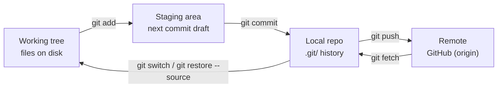

# Git CLI Hands-On Lab Guide: Shortly

Nov 4, 2026 · @Nicolas

## Start here: setup and the mental model

You will learn Git on **Shortly**, the three-tier link shortener from your [Docker capstone](docker-capstone.md). Each lab works on one practice copy, `~/labs/shortly-git`, and starts where the last ended, so do them in order. Every change you make is to files you wrote: Dockerfiles, `compose.yaml`, `nginx.conf`. After each change, `docker compose config -q` and a healthy `docker compose ps` prove the stack still works, the same check the capstone used.

**Lab environment:** your finished `shortly/` folder, Docker with Compose, Git 2.40+, a GitHub account and the [GitHub CLI](https://cli.github.com/). Your real `shortly` repo is never touched; the practice copy runs on port 8081 so both can run at once. Budget 60–90 minutes per lab.

```bash
git --version          # need 2.40 or newer for git switch/restore defaults
mkdir -p ~/labs && cd ~/labs
```

**How each lab is laid out:** Goal → Steps (type every command, don't paste) → Checkpoint (the output you should see) → Why it matters. If your checkpoint output differs, stop and work out why before moving on — that gap is where the learning is.

### The four places your work lives

Git is a content-addressed database of snapshots, not a diff tracker. Almost every confusing moment comes from not knowing which of these four places a change is in:

| Place | What it is | Commands that move work INTO it |
| --- | --- | --- |
| Working tree | Files on disk you edit | `git restore`, `git checkout`, `git switch` |
| Index (staging area) | The draft of your next commit | `git add`, `git restore --staged` |
| Local repo (`.git/`) | Commits, branches, tags — the history | `git commit`, `git merge`, `git rebase` |
| Remote (GitHub) | A shared copy others push to | `git push` (and `git fetch` pulls it back down) |



Nothing leaves your machine until `git push`; `git fetch` is the only way remote changes come back into view.

Three facts carry most of Git:

1. **A commit is a full snapshot** plus a pointer to its parent(s). The SHA is a hash of the content, so changing anything (even the message) makes a new commit.
2. **A branch is a movable label** pointing at one commit. Creating a branch costs 41 bytes; that's why you should branch freely.
3. **`HEAD` is "where you are"** — usually pointing at a branch, which points at a commit.

### How to read the commands

Every lab opens with a **Commands in this lab** table. Read it before you type anything. Each Git command does one of three jobs:

- **Look:** answers a question and changes nothing (`status`, `diff`, `log`, `show`, `blame`). Safe to run anytime, as often as you like.
- **Move:** moves a change between the four places above (`add`, `commit`, `push`, `fetch`, `restore`, `reset`, `merge`). These are the ones to think about before running.
- **Set up:** done once (`config`, `init`, `remote`, `clone`).

The labs also use **helper commands that are not Git**: `sed`, `printf`, `openssl`, `rsync`, `docker compose`. They only make a realistic edit to a file quickly, so you can watch what Git does with it. You could make every one of those edits by hand in an editor; the tables say what each edit is.

One habit makes all of this stick: run `git status` before and after every Move command, and watch the change jump from one place to the next.

## Lab 1: Put Shortly under version control

**Goal:** rebuild Shortly's history from zero, one tier per commit, in the order you built the capstone. `.env` and `secrets/` must never enter Git.

**Commands in this lab**

| Command | What it does | Why you need it here |
| --- | --- | --- |
| `git config --global user.name / user.email` | Sets the name and email stamped on every commit | Git won't commit without it, and GitHub links commits to your account by email |
| `git config --global init.defaultBranch main` | New repos start on a branch called `main` | Matches GitHub's default, so local and remote agree |
| `rsync -a --exclude ...` (helper) | Copies a folder, skipping the paths you list | Makes a practice copy without your real `.git`, `.env` and secret |
| `git init` | Creates the hidden `.git/` folder, the database of history | Turns a plain folder into a repository; nothing is tracked before this |
| `git status` | Shows which files are untracked, modified or staged | Your "where am I?" command; run it constantly |
| `git add <path>` | Copies the file as it is now into the index | Picks exactly what goes into the next commit, and nothing else |
| `git commit -m "..."` | Saves everything in the index as a permanent snapshot | Creates a restore point with a message saying why |
| `printf ... > .env`, `openssl rand` (helpers) | Write the env file and a random password | The stack needs both on disk, but they must never be in Git |
| `git check-ignore -v <file>` | Says whether a file is ignored, and by which `.gitignore` line | Proves your secrets are protected rather than hoping they are |
| `git diff --staged --stat` | Lists staged files and how many lines changed | Last look before committing; catches files you didn't mean to include |
| `docker compose up / ps`, `curl` (helpers) | Start the stack and check its health | Proves what's in Git is enough to run Shortly |
| `git log --oneline --graph` | Lists commits, newest first, with the branch shape | Reads the history you just built |
| `git show <commit>` | One commit's message and changes | Answers "what exactly changed here?" |
| `git log -p -- <file>` | Every change ever made to one file | Answers "when did this setting change?" |
| `git blame <file>` | The last commit to touch each line | Answers "who changed this line, and why?" during an incident |
| `git ls-files` | Lists every file Git tracks | An audit: confirms no secret is tracked |

**Step 1 — Identity and defaults (once per machine)**

```bash
git config --global user.name "Nic Capistrano"
git config --global user.email "you@example.com"   # the email on your GitHub account
git config --global init.defaultBranch main
git config --global pull.rebase false              # explicit merges on pull; revisited in Lab 5
git config --list --show-origin
```

**Step 2 — Make a practice copy without Git, secrets or env**

```bash
SRC=~/path/to/shortly                              # your finished capstone folder
mkdir -p ~/labs
rsync -a --exclude .git --exclude .env --exclude secrets/ "$SRC"/ ~/labs/shortly-git/
cd ~/labs/shortly-git
git init
ls -la .git            # objects/, refs/, HEAD: this folder IS the repository
git status             # every file untracked
```

**Step 3 — Commit `.gitignore` first, then recreate the local-only files**

Order matters: once the ignore rules are committed, `git add .` can't sweep up a secret by accident.

```bash
cat .gitignore                                    # .env and secrets/ from the capstone
git add .gitignore
git commit -m "chore: ignore env files and secrets"

printf 'DB_NAME=shortly\nDB_USER=shortly\nWEB_PORT=8081\n' > .env
mkdir -p secrets && openssl rand -hex 24 | tr -d '\n' > secrets/db_password.txt
git status                                        # .env and secrets/ must NOT appear
git check-ignore -v .env secrets/db_password.txt  # names the .gitignore line that matched
```

**Step 4 — One tier per commit**

The messages use the `type(scope): summary` format from [Conventional Commits](https://www.conventionalcommits.org/). Use it from day one; Lab 6 explains the payoff.

```bash
git add web/
git diff --staged --stat                 # exactly what this commit will hold
git commit -m "feat(web): nginx tier with baked-in config and healthcheck"
git add db/  && git commit -m "feat(db): postgres tier with init.sql schema"
git add api/ && git commit -m "feat(api): multi-stage FastAPI image running as UID 10001"
git add compose.yaml && git commit -m "feat(compose): three tiers, two networks, secret, hardening"
git add README.md DRILLS.md && git commit -m "docs: design rationale and drill notes"
git status                               # nothing to commit, working tree clean
```

**Step 5 — Prove the repo is complete by running it**

```bash
docker compose config -q && docker compose up -d --build
docker compose ps                        # db, api, web all healthy
curl -s localhost:8081/api/health
```

**Step 6 — Read history like an investigator**

```bash
git log --oneline --graph
git show HEAD~2 --stat                   # the api commit: which files
git log -p -- compose.yaml               # every change to one file
git blame compose.yaml | head -30
git ls-files                             # what Git tracks
git ls-files | grep -E '(^|/)\.env$|^secrets/' || echo "no secrets tracked"
```

**Checkpoint:** `git log --oneline` shows 6 commits. The `ls-files` check prints "no secrets tracked". The stack is healthy on port 8081 from files that came out of Git, plus your two local-only files.

**Why it matters:** one tier per commit means you can later revert the api change without touching web or db. A single "initial commit" of everything gives you no such handle.

**Security note:** if `db_password.txt` is ever committed, `.gitignore` won't remove it; it is in history until rewritten. Rotating it is also more than writing a new file. Postgres reads `POSTGRES_PASSWORD_FILE` only when the data volume is first created, so a real rotation means `ALTER USER` inside the db, then updating the file.

## Lab 2: Inspect and undo safely

**Goal:** undo mistakes in each of the four places on Shortly's real files, and learn which undo commands are safe once history is shared.

**Commands in this lab**

| Command | What it does | Why you need it here |
| --- | --- | --- |
| `sed -i 's/old/new/' <file>` (helper) | Find-and-replace inside a file, in place | Makes a realistic mistake (a typo, a version bump) without opening an editor |
| `grep <text> <file>` (helper) | Prints lines containing the text | Quick check of whether a change is there or gone |
| `git diff` | Shows edits on disk that aren't staged yet | See the damage before deciding how to undo it |
| `git restore <file>` | Overwrites the file on disk with the last saved version | Throws away a bad edit. Permanent: the edit is gone |
| `docker compose exec -T db pg_dump ...` (helper) | Exports the database to a `.sql` file | Creates a file full of real data that must not go into Git |
| `git add .` | Stages everything new or changed in the folder | Convenient, and exactly how the dump got swept in by accident |
| `git restore --staged <file>` | Takes a file out of the index; the file on disk is untouched | Undoes a `git add` without losing anything |
| `git commit -am "..."` | Stages all *already tracked* changed files, then commits | A shortcut. It never picks up new files, which is a safety feature |
| `git commit --amend` | Replaces the last commit with a corrected one | Fixes a forgotten file or a bad message, only before pushing |
| `HEAD~1` | Means "one commit before where I am now" | How you point at earlier commits without copying SHAs |
| `git reset --soft HEAD~1` | Moves the branch back one commit; the changes stay staged | "Un-commit" but keep everything ready to commit again |
| `git reset --mixed HEAD` | Same, but changes are unstaged (still on disk) | Re-choose what to stage. It's the default if you just type `git reset` |
| `git reset --hard HEAD~1` | Moves the branch back and wipes the changes from disk | Fully discards local commits. The most dangerous command here |
| `git reflog` | Lists every place `HEAD` has pointed recently | Finds commits that look lost after a bad reset |
| `git reset --hard HEAD@{1}` | Jumps back to where `HEAD` was one move ago | The "undo my undo" button |
| `git revert <commit>` | Adds a new commit that does the opposite of an old one | The only safe undo once others have the commit |

Pick the undo by asking two questions: *where is the mistake* and *has it been pushed?*

| Mistake is in… | Command | Destroys work? | Safe after push? |
| --- | --- | --- | --- |
| Working tree (unsaved edit) | `git restore <file>` | Yes, the edit | n/a |
| Index (staged by mistake) | `git restore --staged <file>` | No | n/a |
| Last commit (message or missing file) | `git commit --amend` | No | No: new SHA |
| Local commits | `git reset --soft / --mixed / --hard <ref>` | `--hard` only | No |
| Pushed commit | `git revert <sha>` | No: adds an inverse commit | Yes |

**Step 1 — Discard a broken edit**

```bash
sed -i 's/proxy_pass/proxy_pas/' web/nginx.conf   # typo that would crash nginx on start
git diff                                         # working tree vs index
git restore web/nginx.conf
git diff                                         # empty
```

**Step 2 — Unstage a file `git add .` swept in**

```bash
mkdir -p backups
docker compose exec -T db pg_dump -U shortly shortly > backups/shortly.sql
git add .
git status                          # backups/shortly.sql staged: real user data heading into Git
git restore --staged backups/shortly.sql
printf 'backups/\n' >> .gitignore
git status                          # only .gitignore modified now
git commit -am "chore: ignore local db backups"
```

**Step 3 — Amend the last commit**

```bash
printf '*.log\n' >> .gitignore
git add .gitignore
git commit --amend -m "chore: ignore local db backups and log files"
git log --oneline -2                # same count, new SHA on top
```

**Step 4 — Feel the three kinds of reset**

```bash
sed -i -E 's/shortly-api:[0-9.]+/shortly-api:1.3.0/' compose.yaml
git commit -am "chore(api): bump image tag to 1.3.0"

git reset --soft HEAD~1  ; git status          # commit gone, change still STAGED
git reset --mixed HEAD   ; git status          # unstaged, still on disk (mixed is the default)
git commit -am "chore(api): bump image tag to 1.3.0"
git reset --hard HEAD~1  ; grep shortly-api compose.yaml   # change GONE from disk
```

**Step 5 — Recover "lost" work with the reflog**

```bash
git reflog                          # every move HEAD made, including the commit you just dropped
git reset --hard HEAD@{1}           # back to before the hard reset
grep shortly-api compose.yaml       # 1.3.0 is back
```

**Step 6 — Revert: the undo for shared history**

```bash
git revert HEAD                     # editor opens with "Revert ..."; save and quit
grep shortly-api compose.yaml       # original tag restored
git log --oneline                   # the bump AND its inverse both exist
docker compose config -q && echo "compose still valid"
```

**Checkpoint:** `git log --oneline` shows 9 commits, ending in a `Revert "chore(api): bump image tag to 1.3.0"` commit. `backups/` exists on disk but `git status` is clean.

**Why it matters:** `reset` rewrites history; `revert` records it. On a branch teammates have pulled, rewriting forces everyone to reconcile diverged copies, which is an incident, not a fix. The reflog is your local safety net for about 90 days, but it is never pushed, so it can't save a teammate.

## Lab 3: Branching and merging

**Goal:** change Shortly on feature branches, see both kinds of merge, and resolve a real conflict in `compose.yaml` without leaving the file broken.

**Commands in this lab**

| Command | What it does | Why you need it here |
| --- | --- | --- |
| `git switch -c <branch>` | Creates a new branch and moves you onto it | Do work in isolation so `main` stays working while you experiment |
| `git switch <branch>` | Moves you to an existing branch and swaps the files on disk to match | Go back to `main` to merge, or to another line of work |
| `cat > file <<'EOF' ... EOF` (helper) | Writes the lines between the markers into a file | Creates `RUNBOOK.md` in one paste instead of an editor |
| `git log --oneline --graph --all` | History of every branch, drawn as a graph | Shows where branches split and rejoin, which is the whole point of this lab |
| `git merge <branch>` | Brings another branch's commits into the one you're on | How finished work gets into `main` |
| Fast-forward (a merge result) | `main` had no new commits, so Git just moves the label forward | No merge commit needed; history stays a straight line |
| Merge commit (a merge result) | Both branches moved, so Git makes a commit with two parents | Records that two lines of work were joined |
| `git branch -d <branch>` | Deletes a branch that's already merged | Cleanup. Refuses if the work isn't merged, so you can't lose it |
| `git check-ignore <file>` | Exits OK if the file is ignored | Confirms `.env.example` is safe to commit while `.env` stays ignored |
| Conflict markers `<<<<<<<` `=======` `>>>>>>>` | Git writes both versions into the file and stops | Git won't guess which port is right; you must decide |
| `docker compose config -q` (helper) | Validates `compose.yaml`; silent if OK, error if not | Proves a resolved file is still valid YAML before you commit it |
| `git add <file>` (during a merge) | Marks the conflict in that file as resolved | Tells Git you've made the decision |
| `git commit` (no `-m`) | Opens your editor with a pre-filled merge message | Finishes the merge |
| `git merge --abort` | Cancels the merge and restores everything | The escape hatch if a conflict is more than you expected |

**Step 1 — Branch, commit, fast-forward merge**

```bash
git switch -c docs/runbook                      # create + switch in one step
cat > RUNBOOK.md <<'EOF'
# Shortly runbook
- Status: docker compose ps
- Logs for one tier: docker compose logs -f api
- Restart one tier: docker compose restart api
EOF
git add RUNBOOK.md && git commit -m "docs: add operator runbook"

git log --oneline --graph --all                 # branch is 1 ahead of main
git switch main
git merge docs/runbook                          # "Fast-forward": main's label just moved
git branch -d docs/runbook
```

A fast-forward happens when `main` hasn't moved since you branched. Git slides the label forward and creates no merge commit.

**Step 2 — Diverge, then make a true merge**

```bash
git switch -c docs/env-example
printf 'DB_NAME=shortly\nDB_USER=shortly\nWEB_PORT=8080\n' > .env.example
git check-ignore .env.example || echo "not ignored, good"   # .env is ignored, the example is not
git add .env.example && git commit -m "docs: add .env.example listing required variables"

git switch main
printf -- '- Full restart: docker compose down && docker compose up -d\n' >> RUNBOOK.md
git commit -am "docs(runbook): add full restart"

git merge docs/env-example                      # editor opens for the merge commit message
git log --oneline --graph                       # diamond = merge commit with 2 parents
```

**Step 3 — Force a conflict on the web port default**

Both branches change the default in `${WEB_PORT:-8080}`. If your compose file writes the default differently, make the same two edits by hand.

```bash
git switch -c feat/web-port-9090
sed -i 's/WEB_PORT:-8080/WEB_PORT:-9090/' compose.yaml
git commit -am "feat(web): default published port 9090"

git switch main
sed -i 's/WEB_PORT:-8080/WEB_PORT:-8000/' compose.yaml
git commit -am "feat(web): default published port 8000"

git merge feat/web-port-9090                    # CONFLICT (content): Merge conflict in compose.yaml
git status                                      # "both modified: compose.yaml"
docker compose config -q                        # fails: conflict markers are not YAML
```

Open `compose.yaml` and find the markers:

```
<<<<<<< HEAD
      - "${WEB_PORT:-8000}:80"
=======
      - "${WEB_PORT:-9090}:80"
>>>>>>> feat/web-port-9090
```

**Step 4 — Resolve it, then prove the stack still works**

1. Decide the right answer: keep 8000 (say the host firewall already allows it).
2. Delete the three marker lines and the losing side. Keep the indentation exactly as it was.
3. Validate before you commit, then finish the merge:

```bash
grep -n '^<<<<<<<\|^=======\|^>>>>>>>' compose.yaml   # must print nothing
docker compose config -q && echo "valid YAML"
git add compose.yaml
git commit                                     # Git pre-fills "Merge branch ..."
git branch -d docs/env-example feat/web-port-9090
docker compose up -d && docker compose ps      # .env still sets 8081, so the stack is unchanged
```

Escape hatch while mid-conflict: `git merge --abort` puts everything back to before the merge.

**Checkpoint:** `git log --oneline --graph` shows two merge diamonds, `git branch` lists only `main`, and `grep WEB_PORT compose.yaml` shows the 8000 default.

**Why it matters:** a conflict is Git refusing to guess a business decision. In an infra repo the right answer often needs a conversation ("which port does the firewall allow?"), not an edit. The other lesson: a resolved file can still be broken YAML, so always run the tool's own validator before you commit the merge.

## Lab 4: Remotes and GitHub

**Goal:** push `shortly-git` to GitHub over SSH, prove a fresh clone can run the stack, simulate a teammate, and run a full pull-request cycle from the CLI.

**Commands in this lab**

| Command | What it does | Why you need it here |
| --- | --- | --- |
| `ssh-keygen -t ed25519` (helper) | Creates a key pair: a private key that stays on your machine, a public key you share | GitHub uses it to know it's you, with no password on every push |
| `ssh-add`, `ssh -T git@github.com` (helpers) | Load the key, then test the login | Confirms authentication works before you blame Git |
| `gh repo create ... --source=. --remote=origin` | Creates the GitHub repo and links your folder to it as `origin` | One step instead of clicking through the website, then `git remote add` |
| `git remote -v` | Lists the remotes this repo knows about | Checks that `origin` points where you think |
| `git push -u origin main` | Uploads your commits; `-u` remembers where to push | First push. After this, plain `git push` is enough |
| `git branch -vv` | Shows each branch and the remote branch it tracks | Confirms `main` is linked to `origin/main` |
| `git clone <url> <folder>` | Downloads a full copy of the repo, with history | Pretends to be a teammate starting from nothing |
| `git config user.name` (no `--global`) | Sets the name for this one repo only | Makes the teammate's commits look like a different person |
| `git fetch` | Downloads new commits from GitHub without changing your files | Lets you look before letting anything into your branch |
| `git log main..origin/main` | Lists commits on GitHub that you don't have yet | Answers "what am I about to pull in?" |
| `git diff main origin/main` | The actual line changes between yours and GitHub's | Same question, in detail |
| `git pull` | `git fetch` followed by `git merge` | Brings your branch up to date |
| Rejected push | GitHub refuses because it has commits you don't | Stops you overwriting a teammate's work. Pull first, then push |
| `gh pr create --fill` | Opens a pull request using your commit message | Asks for review before the change reaches `main` |
| `gh pr merge --squash --delete-branch` | Merges the PR as one commit, then deletes the branch | Keeps `main`'s history short: one PR, one commit |
| `git fetch --prune` | Removes local records of branches deleted on GitHub | Cleanup, so `git branch -a` reflects reality |

**Step 1 — SSH key for GitHub**

```bash
ssh-keygen -t ed25519 -C "you@example.com" -f ~/.ssh/id_ed25519_github
eval "$(ssh-agent -s)" && ssh-add ~/.ssh/id_ed25519_github
cat ~/.ssh/id_ed25519_github.pub     # paste into GitHub > Settings > SSH and GPG keys
ssh -T git@github.com                # "Hi <user>! You've successfully authenticated"
```

**Step 2 — Create the remote and push**

```bash
gh repo create shortly-git --public --source=. --remote=origin   # empty GitHub repo, wired as origin
git remote -v
git push -u origin main              # -u sets upstream so plain "git push" knows where to go
git branch -vv                       # main tracking origin/main
```

**Step 3 — The fresh-clone test (your teammate's first day)**

This is the capstone's "from a fresh clone" check, done properly.

```bash
cd ~/labs && git clone git@github.com:<your-user>/shortly-git.git teammate
cd teammate
ls -la                               # no .env, no secrets/: Git never had them
docker compose up -d                 # fails: the db_password secret file doesn't exist

cp .env.example .env && sed -i 's/WEB_PORT=8080/WEB_PORT=8082/' .env
mkdir -p secrets && openssl rand -hex 24 | tr -d '\n' > secrets/db_password.txt
docker compose up -d --build && docker compose ps   # healthy on 8082
docker compose down -v               # free the resources; the clone stays
```

**Step 4 — Teammate pushes; you fetch, inspect, then pull**

```bash
git config user.name "Teammate Tess"          # repo-local identity, not --global
printf -- '- Rotate the db password: see README\n' >> RUNBOOK.md
git commit -am "docs(runbook): note password rotation" && git push

cd ~/labs/shortly-git
git status                           # "up to date": it only knows what it last fetched
git fetch                            # download only; nothing local changes
git status                           # "behind 'origin/main' by 1 commit"
git log --oneline main..origin/main  # exactly what's incoming
git diff main origin/main
git pull                             # = fetch + merge
```

**Step 5 — Rejected push (the most common real-world error)**

```bash
cd ~/labs/teammate && git pull
printf -- '- On-call: #shortly-ops\n' >> RUNBOOK.md && git commit -am "docs(runbook): add on-call channel" && git push

cd ~/labs/shortly-git
printf -- '- Owner: platform team\n' >> RUNBOOK.md && git commit -am "docs(runbook): add owner"
git push                             # ! [rejected] ... (fetch first)
git pull                             # conflict in RUNBOOK.md: keep both lines, resolve as in Lab 3
git push
```

**Step 6 — Pull request flow from the CLI**

```bash
git switch -c chore/oci-label
printf 'LABEL org.opencontainers.image.source="https://github.com/<your-user>/shortly-git"\n' >> web/Dockerfile
docker compose build web
docker image inspect shortly-web:1.0.0 --format '{{json .Config.Labels}}'   # label is baked in
git commit -am "chore(web): add OCI source label to image"
git push -u origin chore/oci-label
gh pr create --fill                  # PR from the commit message
gh pr view --web                     # review the diff in the browser
gh pr merge --squash --delete-branch
git switch main && git pull
git fetch --prune                    # drop stale remote-tracking branches
```

**Checkpoint:** on GitHub, `main` has the OCI label change as one squashed commit; `git branch -a` shows no `chore/oci-label` anywhere; the teammate clone ran Shortly using only what was in Git plus `.env.example` and a new secret.

**Why it matters:** the fresh-clone test is how you know the repo is the source of truth and not your laptop. And `origin/main` is a *local cache* of the remote, updated only by `fetch`. Most "Git lied to me" moments are reading a stale cache, so `git fetch` then `git log main..origin/main` before acting is the habit that prevents surprise merges.

## Lab 5: Stash, rebase and cherry-pick

**Goal:** park unfinished work, keep a feature branch current with rebase, squash messy commits before a PR, and copy one fix to a release branch.

**Commands in this lab**

| Command | What it does | Why you need it here |
| --- | --- | --- |
| `git stash push -m "..."` | Shelves your uncommitted changes and cleans the working tree | You're interrupted mid-edit and need to switch branches without committing half-done work |
| `git stash list` | Shows what's on the shelf | Reminds you what you parked |
| `git stash pop` | Puts the shelved changes back and removes them from the shelf | Resume exactly where you left off |
| `docker compose config \| grep limits` (helper) | Prints the final compose file as Docker reads it | Checks your `sed` edits landed where you meant |
| `git rebase origin/main` | Re-applies your branch's commits on top of the latest `main` | Brings your branch up to date without a merge commit, so history stays a straight line |
| `git rebase -i origin/main` | Opens a list of your commits so you can squash, reword, reorder or drop them | Turns "wip / more / fix lol" into one commit a reviewer can understand |
| `pick` / `squash` (in the rebase editor) | `pick` keeps a commit; `squash` folds it into the one above | How three commits become one |
| `git log origin/main..HEAD` | Commits on your branch that aren't on `main` | Confirms what your PR will contain |
| `gh pr merge --merge` | Merges with a merge commit (not squashed) | Shows the other merge style next to Lab 4's squash |
| `git log --grep '<text>'` | Finds commits whose message matches | Locates the compose commit to branch the release from |
| `git switch -c release/1.0 <commit>` | Creates a branch starting at an older commit | Simulates a release that was cut earlier |
| `docker compose exec -T db postgres --version` (helper) | Asks the running database its exact version | Pin the image to what you actually run, not a guess |
| `git rev-parse HEAD` | Prints the full SHA of the current commit | Saves the fix's ID so you can copy it elsewhere |
| `git cherry-pick <commit>` | Copies one commit onto the current branch | Ships a single fix to the release without bringing every other change on `main` |
| `git push --force-with-lease` | Overwrites a remote branch, but only if nobody else pushed meanwhile | The safe way to update a branch you rebased after pushing |

**Step 1 — Stash: interrupted mid-change**

```bash
git switch main && git pull
sed -i 's|<title>[^<]*</title>|<title>Shortly (beta)</title>|' web/index.html   # half-done UI tweak
git stash push -m "wip: beta title"
git status                          # clean: you can switch branches freely
# ...handle the urgent thing, then come back:
git stash list
git stash pop                       # reapply and drop from the stash
git restore web/index.html          # decided against it
```

**Step 2 — A messy feature branch, on purpose**

The api is limited to 0.5 CPU and 256M. Raise it in three sloppy commits.

```bash
git switch -c feat/api-limits
sed -i 's/256M/384M/' compose.yaml && git commit -am "wip"
sed -i -E "s/(cpus: *['\"]?)0\.5/\10.75/" compose.yaml && git commit -am "more"
printf -- '- api limits: 0.75 CPU / 384M\n' >> RUNBOOK.md && git commit -am "fix lol"
docker compose config | grep -B1 -A3 limits   # check what Compose actually sees
```

**Step 3 — Meanwhile, main moves (teammate)**

```bash
cd ~/labs/teammate && git pull
printf '*.tmp\n' >> .gitignore && git commit -am "chore: ignore tmp files" && git push
cd ~/labs/shortly-git && git fetch
```

**Step 4 — Rebase onto the new main**

```bash
git log --oneline --graph --all     # your branch forked from an older main
git rebase origin/main              # replays your 3 commits on top of the new tip
git log --oneline --graph           # a straight line, no merge commit
```

**Step 5 — Interactive rebase: squash into one clean commit**

```bash
git rebase -i origin/main
```

In the editor keep `pick` on the first line and change the other two to `squash` (or `s`). Save, then write one real message: `feat(api): raise limits to 0.75 CPU / 384M`.

```bash
git log --oneline origin/main..HEAD # exactly 1 commit now
docker compose up -d && docker compose ps
git push -u origin feat/api-limits
gh pr create --fill && gh pr merge --merge --delete-branch
git switch main && git pull
```

**Step 6 — Cherry-pick a hotfix to a release branch**

Pretend the release branched right after the compose commit, then pin Postgres to the exact version you're running. A floating `16-alpine` tag can change under you on the next pull.

```bash
BASE=$(git log --format=%h --grep '^feat(compose)' -1)
git switch -c release/1.0 "$BASE"
git switch main
PGV=$(docker compose exec -T db postgres --version | awk '{print $3}')   # e.g. 16.4
sed -i -E "s/^FROM postgres:[0-9.]+/FROM postgres:${PGV}/" db/Dockerfile
grep FROM db/Dockerfile
git commit -am "fix(db): pin postgres image to ${PGV}"
FIX=$(git rev-parse HEAD)
git switch release/1.0
git cherry-pick "$FIX"              # same change, new SHA on this branch
git log --oneline -3
git switch main
```

**Checkpoint:** `release/1.0` has the Postgres pin with a different SHA than on `main`. The api limits landed on `main` as exactly one commit, and the stack is healthy with the new limits.

**Why it matters (the golden rule):** never rebase commits other people have already pulled. Rebase makes *new* commits with new SHAs, so anyone holding the old ones now has a diverged history. Rebase your own unshared branch freely; merge or revert on shared ones. To update a pushed branch after rebasing, use `git push --force-with-lease`, never plain `--force`: the lease refuses to overwrite work you haven't seen.

## Lab 6: Team workflow and guardrails

**Goal:** make `shortly-git` behave like a production repo: protected `main`, release tags that match image versions, a hook that blocks secrets, and `bisect` to find the commit that broke `compose.yaml`.

**Commands in this lab**

| Command | What it does | Why you need it here |
| --- | --- | --- |
| Ruleset on `main` (GitHub setting) | GitHub rejects direct pushes and force pushes to `main` | Every change must go through a PR, so there's always a review and a record |
| `git reset --hard origin/main` | Makes your local `main` identical to GitHub's | Throws away the test commit GitHub rejected. Safe only because nobody else has it |
| `git log --grep '^fix'` | Lists only commits whose message starts with `fix` | Shows why consistent message formats pay off during an incident |
| `git tag -a v1.0.0 -m "..."` | Puts a permanent, named label on a commit, with author and date | Marks the exact commit you call version 1.0.0 |
| `git push origin v1.0.0` | Uploads the tag | Tags stay local unless you push them explicitly |
| `gh release create v1.0.0 --generate-notes` | Makes a GitHub Release page from the tag | A human-readable "what's in this version" |
| `git describe --tags` | Names the current commit relative to the nearest tag | The string a pipeline uses to tag images, so an image always maps back to its commit |
| `.git/hooks/pre-commit` | A script Git runs before every commit; a non-zero exit blocks the commit | Stops a secret at your keyboard before it ever enters history |
| `chmod +x` (helper) | Makes the script executable | Git silently ignores hooks that can't run |
| `git add -f <file>` | Stages a file even though `.gitignore` excludes it | The "I know better" override, and the hole the hook closes |
| `git diff --cached --name-only` | Lists staged file names (inside the hook) | How the hook sees what you're about to commit |
| `for ... do ... done` (helper) | Repeats a command several times | Creates a pile of commits quickly so bisect has something to search |
| `git bisect start / bad / good` | Begins a binary search between a known-good and a known-bad commit | Finds the breaking commit in a few steps instead of checking each one |
| `git bisect run <command>` | Runs your test at every step automatically | `docker compose config -q` becomes the judge; Git does the searching |
| `git bisect reset` | Ends the search and returns you to your branch | Always finish with this, or you'll stay on an old commit |
| `git branch -D <branch>` | Force-deletes a branch, even unmerged | Throws away the drill branch, which was never meant to merge |

**Step 1 — Protect main on GitHub**

In the repo: Settings → Rules → Rulesets (or Branches) → a rule for `main`: require a pull request before merging, block force pushes, block deletion. Rulesets are free on public repos; private repos need a paid plan, which is why `shortly-git` is public and must never hold a secret.

```bash
git switch main
printf -- '- test\n' >> RUNBOOK.md && git commit -am "Direct push test"
git push                              # rejected: protected branch
git reset --hard origin/main          # safe here: this commit was never shared
```

**Step 2 — Why you've been writing conventional commits**

Read your history back:

```bash
git log --oneline --grep '^fix'       # every fix, nothing else
git log --oneline --grep '(api)'      # everything that touched the api tier
```

During an incident, "what changed in the db tier this week?" is one command. Tools can also turn these messages into changelogs and version bumps: `feat` means a minor bump, `fix` a patch.

**Step 3 — Tag a release and tie it to your images**

```bash
git tag -a v1.0.0 -m "Shortly: first stable three-tier baseline"   # annotated: author, date, message
git show v1.0.0 --stat
git push origin v1.0.0                # tags are NOT pushed by default
gh release create v1.0.0 --generate-notes
git describe --tags                   # v1.0.0 on the tagged commit; v1.0.0-1-g<sha> one commit later
```

That `git describe` output is how a pipeline can name images, so `shortly-api:v1.0.0` always maps back to one exact commit. Your hand-typed `1.0.0` / `1.1.0` tags in `compose.yaml` are the manual version of this.

**Step 4 — A pre-commit hook that blocks secrets**

Hooks are scripts in `.git/hooks/` that Git runs at fixed points. This one is plain Bash; read every line before you use it.

```bash
cat > .git/hooks/pre-commit <<'EOF'
#!/usr/bin/env bash
# Block secret files by path, even if someone forces them past .gitignore with "git add -f".
if git diff --cached --name-only | grep -Eq '(^|/)\.env$|^secrets/|\.pem$'; then
  echo "pre-commit: .env, secrets/ or a key file is staged. Commit blocked." >&2
  exit 1
fi
# Block lines that look like hard-coded passwords or keys.
if git diff --cached -U0 | grep -E '^\+' | grep -Eq '(PASSWORD|SECRET|API_KEY|TOKEN)[[:space:]]*[:=][[:space:]]*[^$[:space:]]|BEGIN (RSA|OPENSSH) PRIVATE KEY'; then
  echo "pre-commit: possible secret in staged changes. Commit blocked." >&2
  exit 1
fi
EOF
chmod +x .git/hooks/pre-commit

git add -f secrets/db_password.txt && git commit -m "test"   # blocked by path
git restore --staged secrets/db_password.txt
```

The second check skips values starting with `$`, so `${DB_NAME}`-style variables in `compose.yaml` don't trip it. Limitation: `.git/hooks/` is never pushed and `git commit --no-verify` skips it. That's why teams also run the same check server-side (GitHub secret scanning, or a CI job).

**Step 5 — Find the commit that broke compose.yaml with bisect**

Set up a realistic mess: an innocent-looking commit hidden among others.

```bash
git switch -c drill/bisect
for i in 1 2 3; do printf -- "- note $i\n" >> RUNBOOK.md; git commit -qam "docs: note $i"; done
printf '\tbroken: true\n' >> compose.yaml && git commit -qam "chore: tidy compose"   # a tab: invalid YAML
for i in 4 5 6; do printf -- "- note $i\n" >> RUNBOOK.md; git commit -qam "docs: note $i"; done
docker compose config -q              # fails, but which commit did it?

git bisect start
git bisect bad HEAD
git bisect good main
git bisect run docker compose config -q   # Compose's own validator is the test
git bisect reset
git switch main && git branch -D drill/bisect
```

`git bisect run` treats exit 0 as good and non-zero as bad, so any check that exits non-zero on failure can be the test: `config -q`, `hadolint`, a `curl` health probe.

**Checkpoint:** a direct push to `main` is rejected; `v1.0.0` shows under Releases on GitHub; the hook blocks `secrets/db_password.txt` even with `git add -f`; bisect names "chore: tidy compose" as the first bad commit.

**Why it matters:** guardrails turn "please be careful" into "the system won't let you", the same shift as moving from runbooks to automation. Branch protection plus required PR checks is exactly where GitHub Actions plugs in next.

## Break-fix challenges

No answers here, on purpose, like the capstone's `DRILLS.md`. Each drill sets up a realistic mess in `shortly-git`; fix it using only Labs 1–6. Before you type a command, write down three things: the **symptom**, the **root cause**, and **what would have caught it earlier**. Add them to a `GIT-DRILLS.md`. Hints point to a lab, not a command. Temporarily turn off the Lab 6 hook (`chmod -x .git/hooks/pre-commit`) for drills 1 and 2, and turn it back on afterwards.

- [ ] **1. The committed secret.** `git add -f secrets/db_password.txt && git commit -m "add secret"`. Not pushed yet. Remove it from history so it never reaches GitHub. *Hint: Lab 2.* Stretch: write down what you'd do if it *had* been pushed, including the Postgres side of rotation (Lab 1 security note).
- [ ] **2. The committed .env.** Same as drill 1 but with `.env`, buried two commits deep under unrelated commits. *Hint: Lab 5, interactive rebase, the `edit` action.*
- [ ] **3. The leaked database port.** On a branch, publish `5432:5432` on `db` and add it to the `frontend` network. Merge it to `main` with a merge commit and push. Undo it on `main` without rewriting history. *Hint: Lab 2 revert, plus `git help revert` for `-m` on merge commits.* Then write down why this change breaks the design in your README.
- [ ] **4. Conflict markers shipped.** Merge a branch with a conflict, commit `compose.yaml` with the markers still in it, then push. Find it, fix it, and add a check so it can't happen again. *Hint: Lab 3 and Lab 6's hook.*
- [ ] **5. Detached HEAD.** `git checkout v1.0.0`, change the api memory limit, commit, then `git switch main`. Git warns you're leaving a commit behind. Get that commit onto a new branch. *Hint: Lab 2, the reflog.*
- [ ] **6. Wrong branch.** On `main` (locally), make two commits that belonged on `feat/redis-cache`. Move them to that branch and put `main` back on `origin/main`. *Hint: create the branch first, then Lab 2.*
- [ ] **7. Force-push accident.** In the teammate clone, rewrite a feature branch you also have locally and `git push --force` it. Recover your version and push it back safely. *Hint: Lab 5's rule and `--force-with-lease`.*
- [ ] **8. Database dump in a commit.** Commit a 60 MB `pg_dump` (pad it with `fallocate -l 60M backups/big.sql` and `git add -f`) on a feature branch, then push. Read GitHub's warning, then remove the file from the branch history before merging. *Hint: Lab 5, interactive rebase.*

**Self-grade:** you've mastered a drill when you can do it without the hint and explain to a teammate why your fix was safe for everyone else using the repo.

## Cheat sheet

| Task | Command | Lab |
| --- | --- | --- |
| Where am I, what changed? | `git status` · `git diff` · `git diff --staged` | 1 |
| History as a graph | `git log --oneline --graph --all` | 1 |
| One commit in detail | `git show <sha>` | 1 |
| Who changed this line | `git blame <file>` | 1 |
| Stage part of a file | `git add -p <file>` | 1 |
| Discard working-tree edit | `git restore <file>` | 2 |
| Unstage | `git restore --staged <file>` | 2 |
| Fix last commit (unpushed) | `git commit --amend` | 2 |
| Move branch back, keep changes | `git reset --soft <ref>` / `--mixed` | 2 |
| Move branch back, drop changes | `git reset --hard <ref>` | 2 |
| Undo a pushed commit | `git revert <sha>` (merge: `-m 1`) | 2 |
| Find lost commits | `git reflog` | 2 |
| New branch and switch | `git switch -c <name>` | 3 |
| Merge a branch in | `git merge <branch>` | 3 |
| Bail out of a conflict | `git merge --abort` / `git rebase --abort` | 3, 5 |
| Delete merged branch | `git branch -d <name>` | 3 |
| Add remote and first push | `git remote add origin <url>` · `git push -u origin main` | 4 |
| See incoming before merging | `git fetch` · `git log main..origin/main` | 4 |
| Clean stale remote branches | `git fetch --prune` | 4 |
| Park work | `git stash push -u -m "msg"` · `git stash pop` | 5 |
| Update branch onto main | `git rebase origin/main` | 5 |
| Squash/reword before PR | `git rebase -i origin/main` | 5 |
| Copy one commit | `git cherry-pick <sha>` | 5 |
| Safe force push | `git push --force-with-lease` | 5 |
| Release tag | `git tag -a v1.0.0 -m "msg"` · `git push origin v1.0.0` | 6 |
| Find the breaking commit | `git bisect start` · `bad` · `good` · `run` | 6 |

Useful aliases to add once you've typed the long forms enough to know what they do:

```bash
git config --global alias.lg "log --oneline --graph --all --decorate"
git config --global alias.st "status -sb"
git config --global alias.undo "reset --soft HEAD~1"
```

## Mental models to keep, and what comes next

**Three models that replace memorising commands:**

1. **Snapshots and labels.** Commits are immutable snapshots; branches and tags are labels on them. "Rewriting history" really means making new snapshots and moving labels. Ask: *which label moves, and who else is holding the old one?*
2. **Four places.** Every command moves content between working tree, index, local repo and remote. When confused, run `git status` and name which place your change is in.
3. **Local first, share deliberately.** Everything is safe to experiment with until you push. Before pushing, choose the history you want others to inherit — clean it with rebase *before* sharing, and use only revert *after*.

**Risk lens (how you'd explain it to leadership):** Git is the change-record for infrastructure. Protected branches plus required review give you segregation of duties and an audit trail for every change — the same control an auditor asks for in a change-management process, but enforced by the tool rather than a form. The biggest operational risk is secrets in history; the second is force-pushes to shared branches. Both are blocked by the Lab 6 guardrails.

**Bring it home to your real repo:** once the drills feel routine, apply the Lab 6 setup to your actual `shortly` repo: branch protection, the hook, conventional commits from here on, and a `v1.0.0` tag on the commit that passed your capstone checklist.

**Bridge to the next stage, GitHub Actions:** `shortly-git` now has PRs, a protected `main` and release tags, the scaffolding CI/CD hangs on. The capstone's "What's next" list becomes three workflows in `.github/workflows/`:

- On every `pull_request`: `docker compose config -q` and `hadolint` on all three Dockerfiles, made a *required* check in the Lab 6 ruleset.
- Same trigger: build the three images, `docker compose up -d`, then `curl` `/api/health` through Nginx. CI has no `secrets/` folder, so creating the secret file in the job is your first real secrets-handling problem.
- On push of a `v*` tag: build and push `shortly-web`, `shortly-api` and `shortly-db` tagged with the Git tag, the automated version of Lab 6, Step 3.

Write these YAML files yourself from the [workflow syntax docs](https://docs.github.com/en/actions/writing-workflows/workflow-syntax-for-github-actions), the same blueprint-and-look-up approach as the capstone.

**Reference:** [Pro Git book (free)](https://git-scm.com/book/en/v2) — chapters 2, 3 and 7 map to Labs 1–5. `git help <command>` is the authoritative manual offline.
